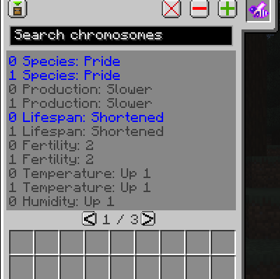

# Forestry IO

Minecraft **1.21.1** / **NeoForge** 模组开发环境，用于开发 **LaserIO × Forestry: Community Edition** 的联动扩展。

- Mod ID：`forestryio`
- Java 包名：`com.zhichaoxi.forestryio`
- 构建系统：Gradle 8.9 + [ModDevGradle](https://github.com/neoforged/ModDevGradle) 2.0.148
- 目标环境：Minecraft 1.21.1 / NeoForge 21.1.240 / Java 21
- 当前版本：`0.1.1`（变更记录见 [`CHANGELOG.md`](CHANGELOG.md)）

## 依赖

| 依赖 | 版本 | 作用 | 许可证 |
| --- | --- | --- | --- |
| [LaserIO](https://github.com/Direwolf20-MC/LaserIO) | 1.9.11 | 必选，编译 + 开发运行 | MIT |
| [Forestry: CE](https://github.com/thedarkcolour/ForestryCE) | 3.0.0-alpha9 | 必选，编译 + 开发运行 | LGPL-3.0-only |
| [Patchouli](https://github.com/VazkiiMods/Patchouli) | 1.21.1-93-NEOFORGE | Forestry 的运行时前置 | CC BY-NC-SA 3.0 |

依赖 jar 放在 `libs/` 中，`build.gradle` 以 `compileOnly` + `runtimeOnly` 的方式引用：

```groovy
compileOnly files("libs/laserio-1.9.11.jar")
runtimeOnly files("libs/laserio-1.9.11.jar")
```

因此它们不会被 shade 进最终 jar，发布时由玩家/整合包自行安装。各 jar 的来源与升级方法见 [`libs/README.md`](libs/README.md)。

## 许可证

本项目以 **GNU Lesser General Public License v3.0 only**（SPDX：`LGPL-3.0-only`）发布，跟随上游依赖的许可证：

- [Forestry: Community Edition](https://github.com/thedarkcolour/ForestryCE) 使用 `LGPL-3.0-only`；本模组直接编译并链接其 `forestry.api` 遗传学接口，作为其附属扩展沿用同一许可证最稳妥；
- [LaserIO](https://github.com/Direwolf20-MC/LaserIO) 使用 MIT；MIT 与 LGPL-3.0 兼容，本项目可以吸收其代码/接口而不违反任何一方条款；
- [Patchouli](https://github.com/VazkiiMods/Patchouli) 使用 CC BY-NC-SA 3.0，仅作为 Forestry 的运行时前置被间接加载；本模组既不打包也不修改其资源。

许可证全文见 [`LICENSE`](LICENSE)（LGPL-3.0 在 GPL-3.0 基础上附加条款，GPL-3.0 全文见 <https://www.gnu.org/licenses/gpl-3.0.txt>）。`gradle.properties` 的 `mod_license` 会经 `processResources` 写入 `META-INF/neoforge.mods.toml` 的 `license` 字段，因此发布 jar 在模组列表里显示的就是该许可证；`LICENSE` 也会被打进 jar 根目录。

合规要点：

- `libs/` 里的三个 jar 只用于编译与开发运行（`compileOnly` + `runtimeOnly`），不会被 shade、也不会随发布 jar 分发，因此不涉及重新分发上游代码；
- LGPL 要求用户能替换/重新链接所链接的库；本项目以源码公开、且不内嵌 Forestry，玩家可自行更换 Forestry 版本，满足该要求；
- 分发修改版时需保留版权与许可证声明，并按 LGPL-3.0 提供对应源码。

## 快速开始

```powershell
# 完整构建（离线）
.\gradlew.bat build --offline

# 启动带 LaserIO / Forestry / Patchouli 的客户端
.\gradlew.bat runClient --offline

# 启动专用服务端（首次启动会生成 run/eula.txt，将其改成 eula=true 后再次启动）
.\gradlew.bat runServer --offline

# 运行数据生成器（输出到 src/generated/resources）
.\gradlew.bat runData --offline
```

构建产物：`build/libs/forestryio-1.21.1-0.1.1.jar`。

用 IntelliJ IDEA 直接打开项目根目录即可；Gradle JVM 选择 JDK 21。`settings.gradle` 默认给 Gradle 加上离线标志，因此 IDE 导入不会卡在仓库连接上。

## 林业过滤器（Forestry Filter）

`forestryio:forestry_filter` 是一个 LaserIO 过滤器物品，按**林业遗传物品的基因组**筛选物品。它原本只支持蜜蜂，
现在也支持树木（树苗 / 花粉）以及林业注册的其它遗传物种（本版本注册了蜜蜂和树木；代码对蝴蝶等其它遗传物种
同样适用，只要对应版本或附属模组提供可放入槽位的物品）。功能对标
[Forestry Oddities](https://www.curseforge.com/minecraft/mc-mods/forestry-oddities) 给机械动力提供的属性过滤器，
但界面沿用 LaserIO「数据过滤器」的布局。



### 获取与使用

- 合成（无序）：`LaserIO 数据过滤器` + `林业 蜂巢` + `林业 树脂`。
- 放入 LaserIO **物品卡**的过滤器槽即可生效（抽取 / 输入两种模式）。
- 右键过滤器本身，或在物品卡界面里**右键过滤器槽**，打开设置界面。

### 界面

- 右上角槽位放一只蜜蜂、一棵树苗、一份花粉或任何林业遗传物品作为**样品**（只做复制，不会消耗；左键放入，
  空手点击清除）。
- 列表列出样品所属物种类型的每一条染色体，`0` 表示显性等位基因、`1` 表示隐性等位基因，例如
  `0 品种: 森林蜂`、`1 品种: 森林蜂`、`0 工作速度: 慢`；放入树苗时则显示 `0 品种: 橡树`、`0 高度: ...`
  等树木染色体。
- 已加入的条件**始终**显示在列表里（蓝色）：即使没有放入样品、样品换成了别的物种，或样品在该染色体上的
  等位基因与已选条件不同，条件也会保留。它排在同一条染色体的行旁边；不属于当前样品物种类型的条件排在
  列表末尾并带物种名前缀，因此不会出现条件仍在生效、界面上却看不到也删不掉的情况。
- **左键**一行：加入 / 移除该条件（已加入的条件显示为蓝色）；**右键**一行：直接移除。
- 顶部搜索框按名称过滤列表；分页按钮或鼠标滚轮翻页。
- 左上角按钮切换**白名单 / 黑名单**；`+` 把样品的全部属性一次性加入；垃圾桶清空全部条件。
- 条件在修改时即同步到服务端，关闭界面时再确认一次。

### 匹配规则

- 每条条件都带有**物种类型**（蜜蜂 / 树木 / 蝴蝶……）。判断时只比较与物品自身物种类型相同的条件，
  其它类型的条件会被忽略；因此同一个过滤器可以同时放入蜜蜂条件和树木条件，分别作用于对应物品。
- 对某个物种类型来说，该类型的全部条件必须同时满足（AND）。物品的物种类型一条条件都没有时，
  该物品**不匹配**（不会因为过滤器里只有蜜蜂条件而放行所有树木）。
- 白名单：只有匹配的物品能通过；黑名单：只有**不**匹配的物品能通过。
- 条件为空时白名单不放行任何物品（与 LaserIO 其它过滤器的空允许列表一致）。
- 每条条件按「物种类型 + 染色体 ID + 显性/隐性 + 等位基因值」精确比较，因此品种、作息、采蜜对象、
  特殊效果、温湿度耐受、工作速度、寿命、穴居、耐雨，以及树木的高度、产量、果实、成熟速度等**任意染色体**
  都能筛选，且不依赖硬编码的属性表。

### 限制

- 只能筛选**携带林业基因组**的物品（本版本为蜜蜂、树苗、花粉；代码同样支持林业以后或其它模组注册的遗传物种，
  如蝴蝶）。原木、蜂巢、蜂蜡等没有基因组的林业物品不在过滤范围内，请使用 LaserIO 的基础 / 标签 / NBT 过滤器。
- 面板使用 LaserIO 数据过滤器的 200×254 贴图与按钮素材，因此 LaserIO 是运行前置。
- 只在物品卡的**抽取 / 输入**模式下参与判断；**存储 / 传感器**模式在 LaserIO 中只识别基础 / 计数 / 标签过滤器，
  本过滤器在这两种模式下不生效（与 LaserIO 自己的数据过滤器一致）。
- 条件以字符串形式存在物品的 `forestryio:filter_rules` 数据组件里，格式为
  `物种类型|染色体|显性/隐性|JSON 值`，读取时会按当前 Forestry 版本重新解析；无法解析的条件会被丢弃，
  不会导致崩溃。旧版本（仅蜜蜂）写入的 `染色体|显性/隐性|JSON 值` 仍可读取，并会在下次保存时升级为新格式。

## 离线

这台机器无法访问 `maven.neoforged.net`，所以：

- `settings.gradle` 默认设置 `gradle.startParameter.offline = true`；
- NeoForge、NeoForm、Parchment、Minecraft 全部来自本机 Gradle 缓存（`D:\Gradle`）；
- 三个 mod jar 来自 `libs/`。

如果以后网络可用，想升级 NeoForge 或改用远程依赖，在命令后加 `-Ponline=true` 即可关闭离线模式。修改 `neo_version` 前请确认该版本已缓存或网络可达。

## 项目结构

```
ForestryIO/
├── LICENSE                      # LGPL-3.0-only 许可证全文（同时打进发布 jar）
├── CHANGELOG.md                 # 版本变更记录（Keep a Changelog 格式）
├── build.gradle                 # ModDevGradle + 依赖 + 资源变量替换
├── gradle.properties            # 版本号、Mod 元数据
├── settings.gradle              # 默认离线、插件仓库
├── gradle/wrapper/              # Gradle 8.9 wrapper
├── libs/                        # 本地依赖 jar（LaserIO / Forestry / Patchouli）
├── docs/                        # 截图与商店页文案（CURSEFORGE.md）
├── design/                      # logo 源文件与设计脚本（refs/ 为本地参考素材，已 gitignore）
├── src/main/java/com/zhichaoxi/forestryio/
│   ├── ForestryIO.java          # @Mod 入口（注册内容 + 网络 + 客户端初始化）
│   ├── item/ForestryFilterItem.java  # 林业过滤器物品（匹配逻辑、规则读写、打开界面）
│   ├── filter/                  # 过滤器规则模型与林业遗传学桥接
│   ├── menu/                    # 过滤器容器与样品槽
│   ├── network/                 # 规则同步数据包
│   ├── mixin/                   # LaserIO 过滤钩子与过滤器界面钩子
│   ├── client/                  # 客户端初始化与界面
│   ├── integration/ModCompat.java
│   └── registry/                # 物品、菜单、数据组件与创造模式标签页注册
├── src/main/resources/
│   ├── META-INF/neoforge.mods.toml
│   ├── forestryio.mixins.json   # Mixin 配置（在 mods.toml 的 [[mixins]] 中注册）
│   ├── pack.mcmeta
│   ├── logo.png
│   ├── assets/forestryio/       # 模型、贴图、中英文语言文件
│   └── data/forestryio/recipe/  # 合成配方
└── tools/make_assets.py         # 生成过滤器贴图与 logo 的脚本
```

## 开发提示

新增联动功能时，建议按现有分层放置代码：物品/方块逻辑放在 `item/` 等目录，跨模组 API 桥接放在
`integration/`，客户端界面放在 `client/`，需要侵入 LaserIO 行为时使用 `mixin/`（新增 Mixin 追加到
`forestryio.mixins.json` 即可）。客户端专用类只在 `FMLEnvironment.dist.isClient()` 分支中注册，避免专用服务端
加载客户端类。

## 元数据与依赖声明

`src/main/resources/META-INF/neoforge.mods.toml` 中声明了以下必选依赖：

```toml
[[dependencies."forestryio"]]
modId = "laserio"
type = "required"
versionRange = "[1.9.11,)"
ordering = "AFTER"
side = "BOTH"
```

Forestry、Patchouli、NeoForge、Minecraft 也同样声明为 required，因此缺少任一依赖时游戏会在加载阶段给出明确报错，而不是运行到一半崩溃。

## 发布前注意

- 不要把 `libs/` 里的第三方 jar 打包进你自己的发布 jar，也不要在未遵守许可证的情况下重新分发它们。
- `mod_license` 目前是 `LGPL-3.0-only`（与 Forestry: CE 一致，见[许可证](#许可证)）。若要更换许可证，必须同时更新
  `LICENSE` 与 `gradle.properties`；已经按 LGPL 发布的版本无法收回，且新许可证不能与 LGPL-3.0 冲突。
- 版本号在 `gradle.properties` 的 `mod_version` 中修改。
- 林业过滤器依赖两个 Mixin 钩子（`BaseCardCacheMixin`、`PacketOpenFilterMixin`），它们在 `neoforge.mods.toml` 的
  `[[mixins]]` 中注册。升级 LaserIO 前请确认 `BaseCardCache#isStackValidForCard(ItemStack)` 与
  `PacketOpenFilter#doOpenFilter(...)` 的方法名/描述符没有变化，否则会在启动时报 Mixin 注入失败。
- 若新增自己的 mixin，继续追加到 `forestryio.mixins.json` 即可；项目使用官方映射，无需 refmap。

## 已验证

- `gradlew build --offline`：成功，`build/libs/forestryio-1.21.1-0.1.1.jar` 的 `META-INF/neoforge.mods.toml`
  中 `version = "0.1.1"`、`license = "LGPL-3.0-only"`，jar 根目录包含 `LICENSE`（7427 字节）；
- `gradlew runData --offline`：成功，Mod 列表包含 Forestry、Forestry IO、LaserIO、Patchouli；
- `gradlew runServer --offline`：专用服务端启动到 `Done`，日志输出
  `Forestry IO loaded: LaserIO=true, Forestry=true, Patchouli=true` 与
  `Forestry Filter: LaserIO filter hook loaded.`（说明 Mixin 已成功注入 LaserIO）；
- 服务端自检（本次临时脚本，在林业物种加载完成后的 `ServerStartedEvent` 阶段运行）：
  - 物种类型解析为 `forestry:bee_species` / `forestry:tree_species`，加载 69 个蜂种、50 个树种；
  - 蜜蜂样品列出 26 条条件，树苗样品列出 20 条条件；
  - 蜜蜂过滤器接受蜜蜂、拒绝树苗；树木过滤器接受树苗、拒绝蜜蜂；
  - 混合过滤器同时接受蜜蜂与树苗；黑名单拒绝匹配的蜜蜂、放行没有基因组的泥土；
  - 全部条件的序列化 / 反序列化往返成功，旧版「仅蜜蜂」格式也能正确解析；
- `gradlew runClient --offline`：客户端进入单人世界，林业过滤器界面成功渲染（见上方截图）。

> 上面三条运行时验证来自 0.1.0 开发期的完整运行；0.1.1 只改动许可证、文档与过滤器列表显示逻辑，构建产物已重新验证。
