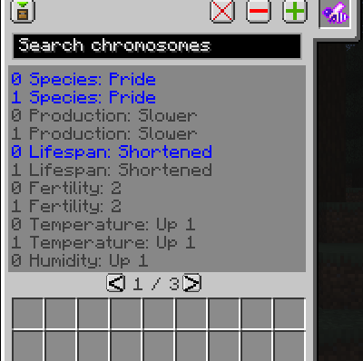

<!--
Suggested CurseForge summary (the short field above the description):
A genome-aware LaserIO filter for Forestry: Community Edition. Route bees, saplings, pollen and other genetic items by species, production, height and every other chromosome.

Before publishing: upload docs/forestry_filter_gui.png to the project gallery and replace the raw GitHub URL below with the CDN URL CurseForge gives you.
-->

**A genome-aware LaserIO filter for Forestry: Community Edition.**

Two Forest princesses are the same item ID to LaserIO, even when their genomes differ. So are two oak saplings, whatever their height or fruit. LaserIO's filters can match item IDs, tags, NBT and mods — but none of them understands the genome that actually makes two Forestry individuals different.

Forestry IO adds the missing piece: the **Forestry Filter**, a LaserIO filter that reads a Forestry item's genome and keeps or rejects it based on any chromosome — species, production, lifespan, temperature and humidity tolerance, tree height, sappiness, fruit, and everything else Forestry defines.

*Minecraft 1.21.1 · NeoForge 21.1+ · LaserIO 1.9.11+ · Forestry: CE 3.0.0-alpha9+*

## Features

- **Filter by any chromosome.** The list is built from the sample's real karyotype, so there is no hard-coded attribute table to fall behind. Species, production, lifespan, fertility, temperature and humidity tolerance, cave dwelling, rain tolerance, effects, tree height, girth, saplings, yield, fruit, maturation — if Forestry exposes it as a chromosome, you can filter on it.
- **Both alleles, not just the dominant one.** Every chromosome is listed twice: `0` for the active allele, `1` for the inactive one.
- **Species-type aware.** Conditions are grouped by species type, so one filter can hold bee rules and tree rules at the same time. Each item is only checked against the conditions for its own species type.
- **Bees and trees out of the box**, plus any other genetic species type that Forestry or an add-on registers — butterflies included, as soon as their species type and genome-bearing items exist.
- **Allow list or deny list.** Invert the whole filter with one button.
- **Searchable, paged list.** Filter the chromosome list by name and page through it with the arrow buttons or the mouse wheel.
- **Selected conditions never disappear.** Every condition already in the filter stays in the list, even with no sample, after switching to another species type, or when the sample carries a different allele value on that chromosome. Foreign conditions are prefixed with their species type, so you can always see and remove what is actually filtering.
- **Ghost sample slot.** Drop in a bee, sapling, or pollen; the item is copied, never consumed.
- **Add all, remove one, clear all.** Build a precise filter line by line, or add every attribute of the sample in one click.
- **Safe persistence.** Conditions live in the item's `forestryio:filter_rules` data component, are re-validated server-side, and survive Forestry updates. A condition that no longer resolves is dropped instead of crashing the game.

*`0` = active allele, `1` = inactive allele. Blue rows are conditions already in the filter.*

## Requirements

| Component | Requirement | Notes |
| --- | --- | --- |
| Minecraft | 1.21.1 | |
| NeoForge | 21.1 or newer | |
| LaserIO | 1.9.11 or newer | Required |
| Forestry: CE | 3.0.0-alpha9 or newer | Required |
| Patchouli | 1.21.1-92 or newer | Required by Forestry |
| Side | Client **and** server | Matching runs on the server; the screen is client-side |

Forestry IO does not bundle any of these mods. A missing dependency stops the game at load time with a clear error instead of failing later.

## Crafting

Shapeless:

- 1× **LaserIO Data Filter** (`laserio:filter_nbt`)
- 1× **Honey Comb** (`forestry:honey_comb`)
- 1× **Propolis** (`forestry:propolis`)

→ 1× **Forestry Filter**

Honey combs and propolis come from Forestry apiaries; the Data Filter from LaserIO.

## How to use

1. Craft the filter and place it in the **filter slot of a LaserIO Item Card**.
2. Right-click the filter in your hand, or right-click its slot in the card's interface, to open the configuration screen.
3. Put a sample in the slot at the top right: any Forestry genetic item — a bee (drone, princess, or queen), a sapling, or pollen. Shift-click a genetic item in your inventory to copy it in. The sample is never consumed.
4. Click a row to add or remove that condition. **Blue** means the condition is active. **Right-click** a row to remove it.
5. Use the top-left button to switch between **allow list** and **deny list**.
6. Set the card to **Extract** or **Insert** mode.

Every change is sent to the server immediately, so closing the screen is safe.

**Tips**

- The `+` button adds every attribute of the sample; the trash button clears everything. Start with "add all", then remove the lines you do not need.
- The search box matches both chromosome and allele names.
- The filter's tooltip shows the mode, the number of conditions, and the first six conditions.

## How matching works

- A condition is **species type + chromosome + side (0/1) + allele value**, compared exactly.
- Conditions are grouped by species type. For a given item, **only the conditions of its own species type are evaluated**, and all of them must match (AND).
- Conditions for other species types are ignored — that is what lets one filter hold bee and tree rules side by side.
- If an item's species type has **no conditions at all** in the filter, the item **does not match**. In allow mode, a filter with only bee rules never lets saplings through.
- **Allow list:** only matching items pass. **Deny list:** only non-matching items pass.
- An empty allow list passes nothing; an empty deny list passes everything — the same convention as LaserIO's own filters.

**Example:** an allow list with `0 Species: Forest` and `0 Production: Slow` passes Forest bees whose active Production allele is Slow. Forest bees with any other production value, other bee species, and every sapling are rejected.

## What it filters — and what it doesn't

**Works on** anything that carries a Forestry genome: bees (drones, princesses, queens), saplings, pollen, and butterflies or other genetic species once their species type is registered.

**Does not work on** Forestry items without a genome — logs, combs, wax, honey drops, royal jelly, frames. Use one of LaserIO's Basic, Tag, or Data Filters instead.

**Card modes:** the filter is evaluated in **Extract** and **Insert** modes. LaserIO's **Stock** and **Sensor** modes only recognise Basic, Counting, and Tag Filters, so the Forestry Filter is not evaluated there — exactly like LaserIO's own Data Filter.

**Condition limit:** up to 96 conditions per filter, enough to combine the full chromosome sets of several species types.

## Compatibility

- **LaserIO.** Hooks into `BaseCardCache#isStackValidForCard(ItemStack)` and `PacketOpenFilter#doOpenFilter` with two Mixins. Updating LaserIO may require a Forestry IO update. If a hook can no longer be applied, the failure is logged instead of silently matching nothing.
- **Forestry: CE.** All genome access goes through the public `IForestryApi`, so Forestry updates that keep that API do not break existing filters. Conditions that no longer resolve (a removed chromosome or allele) are discarded on read and never crash the game.
- **Existing filters.** Filters written by the earlier bee-only development builds are still readable and are upgraded to the current format the next time they are saved.
- **Other add-ons.** No conflicts are known. A filter keeps working as long as the chromosomes it references still exist.

## Installation

1. Install Minecraft 1.21.1 with **NeoForge 21.1+**.
2. Put **LaserIO**, **Forestry: CE**, **Patchouli**, and **Forestry IO** into the `mods` folder.
3. Start the game. The filter appears in the **Forestry IO** creative tab.

For a dedicated server, install the same four mods on the server. Forestry IO is required on both sides.

## FAQ

**Nothing passes through my filter.**
Check that the allow list has at least one condition for that item's species type, that the condition is blue (selected), and that the card is in Extract or Insert mode. An allow list with no conditions rejects everything by design.

**The list stays empty after I insert an item.**
The sample has no genome. Use a bee, sapling, or pollen — logs, combs, and wax do not carry one.

**Can I filter butterflies?**
Yes, as soon as a species type for them is registered (for example by Forestry: CE - Butterflies). The filter is species-type agnostic; it reads whatever karyotype the sample has.

**Can I combine it with item ID or NBT matching?**
Not inside one Forestry Filter. Use a Basic or Data Filter in another card, and the Forestry Filter for the genome.

**Does it work in Stock and Sensor cards?**
No. Those modes only evaluate LaserIO's Basic, Counting, and Tag Filters.

**Do I need it on the server?**
Yes. Matching happens on the server; the configuration screen is client-side. Install it on both.

**Will my conditions survive a Forestry update?**
They are stored as strings and re-parsed against the current Forestry version. Valid conditions survive; conditions whose chromosome or allele no longer exists are dropped silently.

## Links

- **Source and issue tracker:** [github.com/zhichaoxi2006/forestryio](https://github.com/zhichaoxi2006/forestryio)
- **LaserIO:** [CurseForge](https://www.curseforge.com/minecraft/mc-mods/laserio)
- **Forestry: CE:** [CurseForge](https://www.curseforge.com/minecraft/mc-mods/forestry-community-edition)
- **Patchouli:** [CurseForge](https://www.curseforge.com/minecraft/mc-mods/patchouli)

## Credits

Forestry IO is an add-on and is not affiliated with the authors of LaserIO or Forestry.

- **LaserIO** by Direwolf20 and contributors (MIT)
- **Forestry: Community Edition** by thedarkcolour and contributors (LGPL-3.0-only)
- **Patchouli** by Vazkii and contributors (CC BY-NC-SA 3.0)
- Inspired by Forestry Oddities' attribute filter for Create

## License

Forestry IO is released under the **GNU Lesser General Public License v3.0 only** (`LGPL-3.0-only`), the same license as Forestry: Community Edition. The full text is in the [LICENSE](https://github.com/zhichaoxi2006/forestryio/blob/main/LICENSE) file and is also shipped inside the released jar.

You are free to include Forestry IO in modpacks and to redistribute it, or modified versions of it, under the terms of LGPL-3.0-only. Modified versions must keep the copyright and license notices and make the corresponding source available; the source of this project is on [GitHub](https://github.com/zhichaoxi2006/forestryio).

The third-party mods listed above keep their own licenses.

<!-- The license is set by mod_license in gradle.properties and baked into the jar metadata; keep this section, README and LICENSE in sync. -->
